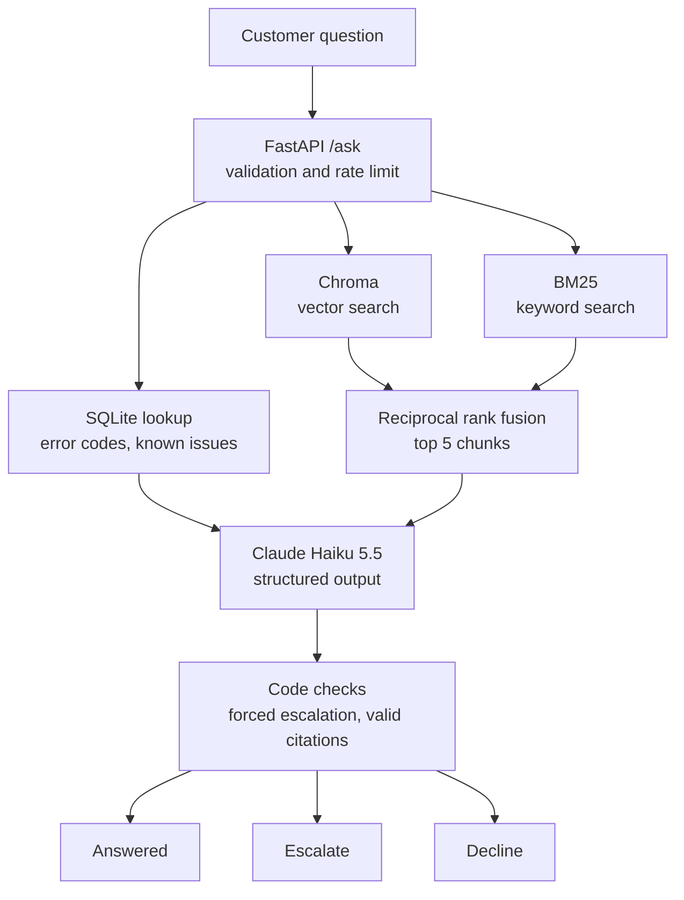
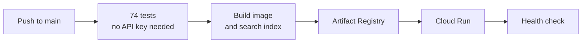

# Veloria Technical Support Assistant

An AI support agent that answers customer questions **only from company documentation, cites its sources, and knows when to hand over to a human**.

**Live demo:** https://veloria-support-assistant-i5tlxei6da-ew.a.run.app/

`Python 3.13` · `FastAPI` · `Claude Haiku 5.5` · `Chroma` · `BM25` · `SQLite` · `Docker` · `GitHub Actions` · `Google Cloud Run`

> Veloria Systems is a fictional company. Its products, articles, tickets and error codes were made up for this project.

---

## The project in one minute

**The problem.** A support chatbot can do real damage by being confidently wrong: inventing a menu path, giving steps for a version that no longer exists, or telling someone with a swollen battery to restart the laptop.

**What I built.** A retrieval-augmented (RAG) assistant that sorts every question into one of three outcomes:

| Outcome | When | Example to try in the demo |
|---|---|---|
| **Answered** | The sources cover it | *VeloSync shows error VS-1042 and one file never syncs. What should I do?* |
| **Escalate** | A human must handle it | *My VeloBook battery looks swollen and the case is bulging. What should I do?* |
| **Decline** | Out of scope or not in the sources | *My printer will not print from Word, can you help?* |

**The result.** On a 37-question test set, run twice:

| Right outcome | Escalations caught | False escalations | Strict pass rate | Cost per answer | Median response (local) |
|---|---|---|---|---|---|
| **100%** (74/74) | **100%** (14/14) | **0** of 60 | **74%** ± 10 | **~$0.0002** | **1.6 s** |

The gap between 100% and 74% is the most interesting part: it picks the right *kind* of response, but not always a perfect *text*. [Evaluation](#evaluation) explains why, and what these numbers do not prove.

---

## Key moments

The six decisions I would want to talk about.

> [!IMPORTANT]
> **🔑 1. Vector search alone was not enough.**
> Embeddings understand meaning but handle exact terms such as `VG-619` poorly. I search three ways: by meaning (Chroma), by keyword (BM25), and by direct lookup in SQLite for error codes and known issues. Reciprocal rank fusion merges the first two by *rank*, because their scores are on different scales.
> → [app/retrieval.py](app/retrieval.py)

> [!IMPORTANT]
> **🔑 2. Safety does not depend on the model alone.**
> If a customer names an error code that the data marks `escalate=true`, *code* forces the escalation, whatever the model decided. Only exact code matches count, since a keyword match can be a coincidence. Citations are checked too: any source ID the model was not given is removed.
> → [app/rag_chain.py](app/rag_chain.py)

> [!IMPORTANT]
> **🔑 3. A stricter evaluation changed what I worked on.**
> My first prompt was tuned on 16 sample questions. A new set of 37 and a strict judge scored it at only 65%, and 22 of the 26 failures had the same cause: plausible details the sources did not contain. Three prompt rules, including *"a shorter answer that stays within the sources is better"*, took grounded answers from 70% to 80%.
> → [evals/](evals/)

> [!IMPORTANT]
> **🔑 4. The judge needed debugging too.**
> Early on, some good answers were marked wrong. The judge could not see the assistant's own instructions, so it called facts from them invented, and it listed claims as errors while describing them as allowed. I gave it the instructions and asked for a separate verdict on every claim. An evaluation is code, and it can have bugs.
> → [evals/judge.py](evals/judge.py)

> [!IMPORTANT]
> **🔑 5. I shipped the version with the lower score, knowingly.**
> Prompt v3 scored 74% against 78% for v2, a difference within the ±9–10 point noise. But it wrote steps as a numbered list in 37 of 54 non-declined replies instead of 19, which is much easier to follow. It also introduced one real regression, which I documented rather than hid: see [Known limitations](#known-limitations).

> [!IMPORTANT]
> **🔑 6. A public AI demo is a public bill.**
> Every question costs money, so the app limits each visitor to 10 questions a minute and 100 a day, Cloud Run is capped at 3 instances, and the API account has a monthly spend limit. The limiter reads only the part of `X-Forwarded-For` added by Google's proxy, so a faked header does not get around it.
> → [app/rate_limit.py](app/rate_limit.py)

---

## How it works



1. **Ingest.** 15 articles, 15 tickets and a PDF manual are cleaned and split into 73 chunks. The deprecated article and the unresolved ticket are left out on purpose. 18 error codes and 5 known issues go to SQLite.
2. **Retrieve.** If the question names a code, its record is looked up directly. If not, SQLite full-text search tries the customer's own words. Both are added to the hybrid search results.
3. **Generate.** Claude returns a typed object (outcome, answer, cited sources, escalation reason), so there is no free text to parse.
4. **Check.** Code applies the escalation and citation rules before anything reaches the customer.

### Design choices

| Choice | Why |
|---|---|
| Claude Haiku 5.5, low effort | Fast and cheap. A stronger model, Sonnet 5.5, judges it in the evaluation |
| Local embeddings (MiniLM) | No extra API cost, and small enough to ship inside the image |
| Search index built into the Docker image | The container starts ready, and the index always matches the code |
| Plain HTML, CSS and JavaScript | No build step needed for one page. Model output is inserted as text, never as HTML |
| Logs record the outcome, not the question | Customers may type personal details |
| Documents and questions treated as data | The prompt tells the model to ignore instructions inside them, and the test set includes an injection attempt |

---

## Evaluation

37 questions: 20 to answer, 7 to escalate and 10 to decline. I wrote 5; the other 32 are AI-generated in the same style. Each runs twice, giving 74 graded answers.

An answer **passes only if everything is right**: the outcome, an expected source, no unsupported claim, and every key point. One extra detail fails the whole answer.

| Version | Change | Pass | Right outcome | Grounded | Escalation recall | False escalations |
|---|---|---|---|---|---|---|
| Baseline | | 65% | 96% | 70% | 100% | 1 |
| v1 | Stay inside the sources | 72% | 97% | 80% | 100% | 0 |
| v2 | Steps on numbered lines | **78%** | 100% | **81%** | 100% | 0 |
| **v3 (live)** | Numbered list for any two or more actions | 74% | 100% | 80% | 100% | 0 |

**Reading this honestly:**

- The margin on the pass rate is ±9–11 points, so neighbouring versions are not clearly different.
- I tuned v1 to v3 on these same questions, so they are no longer truly held out. A fresh set would probably score lower.
- 14 escalation runs are 7 questions asked twice. 100% is encouraging, not proof.
- Cost and response time are measured by the same runs: about $0.0002 per answer, while judging costs about $1 per run.

Full reports: [baseline](.claude/hillclimb/heldout/report.md) · [v1](.claude/hillclimb/heldout/report_v1.md) · [v2](.claude/hillclimb/heldout/report_v2.md) · [v3](.claude/hillclimb/heldout/report_v3.md)

---

## From commit to production



- **No keys in GitHub.** GitHub Actions signs in through Workload Identity Federation, and Cloud Run reads the API key from Secret Manager.
- **Failed revisions stay out.** Cloud Run checks `/health` before sending traffic, so a revision that cannot load its index never goes live.
- **Pull requests** run the tests and build the image, but never deploy.
- **The image holds only what the app needs.** Tests, evaluations, secrets and README files are excluded.

Setup guide: [docs/deploy.md](docs/deploy.md)

---

## Known limitations

| Limitation | What I would do next |
|---|---|
| Asked about a 4-month-old version on the Team plan, v3 says "No" and then gives details that mean "yes" (both runs) | Fix the prompt's yes/no rule and test on new questions |
| Some labels are debatable: a question about unsupported L2TP gets the correct supported alternative but is sometimes labelled *decline* | Tighten the rule and add more such cases |
| Each question is independent, with no conversation memory | Pass recent turns and rewrite follow-up questions before searching |
| Rate limits are kept in memory for each instance and reset on restart | Move the counts to a shared store such as Redis |
| The judge was not checked against human ratings | Label a sample by hand and measure agreement |
| Escalation shows a message but opens no ticket | Connect a help desk API |

---

## Questions I expect

**Why RAG and not fine-tuning?** Support content changes often. With RAG I update a document and rebuild the index, and every answer can point to its source.

**How do you know it doesn't hallucinate?** It sometimes does: about one answer in five contains at least one claim the strict judge finds unsupported. I measure it, and the riskiest topics go to a human.

**Why not use a bigger model?** Outcome accuracy is already 100% on this set. 15 of the 19 failing answers contain an unsupported claim, so I would first try a check that removes unsupported claims, then compare models with the same evaluation.

**What would break at scale?** The in-memory rate limits, the keyword index held in memory, and rebuilding the image for every content change. I would move to a managed vector database, a shared store and a separate ingestion job.

---

## Run it yourself

You need an [Anthropic API key](https://console.anthropic.com/). Put it in a file called `.env`:

```
ANTHROPIC_API_KEY=your-key
```

**With Docker**

```bash
docker compose up --build
```

**Without Docker** (Python 3.13)

```bash
python -m venv venv
source venv/bin/activate        # Windows: venv\Scripts\activate
pip install -r requirements-dev.txt
python -m app.ingest
uvicorn app.main:app --port 8000
```

Open http://localhost:8000, or http://localhost:8000/docs for the API.

**Tests** (free, every Claude call is faked)

```bash
python -m pytest -q
```

## Project structure

```
app/
  ingest.py        documents -> chunks -> Chroma and SQLite
  database.py      SQLite tables and full-text search
  retrieval.py     hybrid search and exact lookups
  rag_chain.py     prompt, Claude call, safety checks
  rate_limit.py    per-visitor limits
  main.py          API and static frontend
data/              articles, tickets, error codes, PDF manual, test questions
evals/             evaluation runner, judge, report
frontend/          chat page
tests/             74 tests
docs/deploy.md     Google Cloud setup
```
